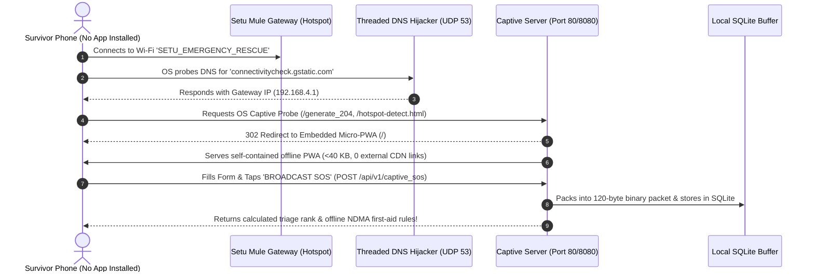

# Breaking the Pre-Installation Paradox: Native Android & Zero-Install Captive Gateway

### *Part 4: Deploying on Real Hardware, On-Device Vernacular Speech Triage, and Offline Micro-PWAs*

---

## 1. The Pre-Installation Paradox

Every disaster application faces an insurmountable adoption hurdle: **The Pre-Installation Paradox**.
* When the sun is shining, citizens do not download disaster survival apps.
* When the cyclone makes landfall and the cellular towers collapse, **it is too late**: Google Play Store and Apple App Store are completely unreachable.

If a system requires 100% of the population to have installed an app before the catastrophe, **it is practically useless**.

In this concluding installment of the Setu series, we explain how we resolved this paradox by pairing a **native offline Android engine** with a **zero-install captive gateway & micro-PWA**.

---

## 2. Native Android Architecture: 100% Offline, Battery-Conscious

We engineered the native Android app using modern **Kotlin**, **Jetpack Compose (Material 3)**, and **Coroutines**, targeting Android 8.0 (API 26) through Android 15/16 (API 36).

```
                           Android System Boundary
┌────────────────────────────────────────────────────────────────────────┐
│                        MainActivity & Compose UI                       │
│      ┌───────────────┐     ┌────────────────┐    ┌─────────────────┐   │
│      │   Help Tab    │     │   Bhasha Tab   │    │   Nearby Tab    │   │
│      │  (One-Tap SOS)│     │ (Indic SLM ASR)│    │ (Radar Receiver)│   │
│      └───────┬───────┘     └────────┬───────┘    └────────┬────────┘   │
└──────────────┼──────────────────────┼─────────────────────┼────────────┘
               │                      │                     │
┌──────────────▼──────────────────────▼─────────────────────▼────────────┐
│                  EmergencyBackgroundService (Foreground)               │
│                                                                        │
│  ┌───────────────────────┐                  ┌───────────────────────┐  │
│  │ AndroidBleAdvertiser  │                  │   NearbySosScanner    │  │
│  │ (BLE 5.0 Extended ADV)│                  │ (BLE 5.0 Periodic RX) │  │
│  └───────────────────────┘                  └───────────────────────┘  │
│  ┌───────────────────────┐                  ┌───────────────────────┐  │
│  │ AcousticTransmitter   │                  │ RubbleSoundClassifier │  │
│  │ (18.5 kHz Chirp Gen)  │                  │ (IMU Jerk + Mic Audio)│  │
│  └───────────────────────┘                  └───────────────────────┘  │
│  ┌──────────────────────────────────────────────────────────────────┐  │
│  │              NearbySosStore (Local Encrypted SQLite DB)          │  │
│  └──────────────────────────────────────────────────────────────────┘  │
└────────────────────────────────────────────────────────────────────────┘
```

### The 3 Core UI Workflows:

1. **"Help" Tab (Survivor One-Tap)**:
   * A prominent emergency SOS activation button.
   * Granular condition selectors: Trapped in rubble, flood water level, severe bleeding, crush injury, insulin/dialysis requirement, pregnant mother, child count.
   * Offline emergency NDMA first-aid advice card that appears immediately.
2. **"Bhasha" Tab (Vernacular Voice Triage)**:
   * Supports **Hindi, Telugu, Tamil, Marathi, Odia, and English**.
   * On-device speech extractor runs completely offline.
   * Automatically parses messy civilian speech into structured clinical fields (disaster type, headcount, medical flags).
   * Example: *"पानी छत तक आ गया है, 2 बच्चे हैं"* $\to$ Extracts `Disaster = FLOOD`, `Headcount = 3`, `Children = 2`, `Trapped = True`.
3. **"Nearby" Tab (Tactical Radar & Data Mule)**:
   * Scans the airwaves for incoming BLE 5.0 beacons and ultrasonic chirps.
   * Displays detected survivors in real time with distance estimation (RSSI/TDoA), severity color codes (RED, YELLOW, GREEN), and medical necessity alerts.
   * Allows responders to track survivor signals with compass bearing guidance.

---

## 3. The Zero-Install Solution: Captive Portal Gateway & Micro-PWA

To rescue the 95% of survivors who **never installed the app**, any responder or citizen running Setu can toggle **"Gateway Mule Mode"**.

The phone turns on its standard Wi-Fi Hotspot (SSID: `SETU_EMERGENCY_RESCUE`, open, no password). When desperate survivors connect their iPhones, Androids, or laptops:



### 1. Asynchronous UDP DNS Hijacker
Every operating system sends DNS queries immediately upon Wi-Fi association. Our lightweight DNS server answers **all A-record queries** with the local gateway IP:

```python
# Real implementation from gateway_mule/captive_portal_server.py
class DnsHijackHandler(socketserver.BaseRequestHandler):
    def handle(self):
        data, sock = self.request
        # Extract DNS transaction ID and construct synthetic A-record answer
        # pointing to target gateway IP (e.g. 192.168.4.1)
        response = self.build_dns_response(data, self.server.target_ip)
        sock.sendto(response, self.client_address)
```

### 2. Multi-OS Captive Probe Redirection
The HTTP server detects OS-specific probe URLs:
* **Android**: `/generate_204`, `/gen_204`
* **Apple iOS & macOS**: `/hotspot-detect.html`, `/library/test/success.html`
* **Windows**: `/ncsi.txt`, `/connecttest.txt`

It instantly serves a **302 Found** redirecting to `/` or serves the embedded micro-PWA directly, triggering the OS-level system pop-up dialog: *"Log in to Wi-Fi network"*.

### 3. The Standalone Micro-PWA (<40 KB, Zero CDN Dependencies)
The served PWA is completely self-contained in a single string template:
* **Zero external fonts, CSS, or JS libraries** (no unresolvable Google Fonts or CDNs).
* Multilingual UI with instant language switching.
* High-contrast tactical design that remains legible in glaring sunlight or dark basements.
* Submitting the form calls `POST /api/v1/captive_sos`:
  * Synthesizes a valid 120-byte binary packet with valid CRC-16.
  * Ingests the record into the mule’s SQLite database.
  * Returns immediate offline NDMA medical survival advice (e.g., *"Elevate wound above heart, apply direct firm pressure"*).

---

## 4. Hardware Deployment & Over-the-Air Validation

We tested the end-to-end system across physical Android hardware:
1. **Device 1 (Survivor Edge)**: Vivo 1718 (Android 8.1 Oreo, API 27).
2. **Device 2 (Responder Mule)**: Motorola Edge 50 Pro (Android 14, API 34).

### Test Sequence:
1. **Zero Connectivity**: Cellular data, SIM cards, and home Wi-Fi were completely disabled on both devices.
2. **Triggering SOS**: On the Vivo device, we tapped **"Help" $\to$ "Broadcast SOS"**.
3. **Over-The-Air Detection**: On the Motorola device (running 25 meters away in another room separated by concrete walls), the **"Nearby"** tab instantly detected the BLE 5.0 extended advertisement packet.
4. **Decoded Telemetry**:
   * Exact GPS coordinates and altitude
   * Severity: **RED**
   * Medical Flag: **Insulin Needed**
   * Battery: **18% (Cryo-Sleep Engaged)**
   * Transmission medium: **BLE 5.0 Extended Advertising (120 Bytes, CRC16 Valid)**

Zero internet. Zero external servers. Zero cost.

---

## 5. Summary & Key Takeaways of the Setu System

Over this 4-part series, we walked through the complete engineering of **Setu**:

1. **Part 1 (Architecture)**: 4-layer survival mesh, solving the Pre-Installation Paradox, and the 120-byte compact binary SOS packet.
2. **Part 2 (Physics Under Concrete)**: The **Cryo-Sleep** battery stretcher (119.4x power reduction, lasting 12.4 days) and the **SAR-Tap** non-vocal seismic IMU codec for crushed-chest survivors.
3. **Part 3 (Mathematical Triage)**: **Ultrasonic GCC-PHAT TDoA** for 3D sub-surface rubble depth localization and the **Dynamic Golden-Hour Trauma Decay Engine** with multi-team dispatch optimization.
4. **Part 4 (Android & Zero-Install)**: Native Jetpack Compose app and the self-contained 40 KB Captive Portal Micro-PWA.

### Open-Source Repository
All source code, Android projects, algorithms, and tests are open-sourced under the MIT License:

🔗 **GitHub Repository**: [https://github.com/charan-143/setu-zero-grid-disaster-mesh](https://github.com/charan-143/setu-zero-grid-disaster-mesh)

*If this architecture inspired you or can help your community in disaster preparedness, give the repository a star on GitHub and share these articles with emergency response engineers!*
